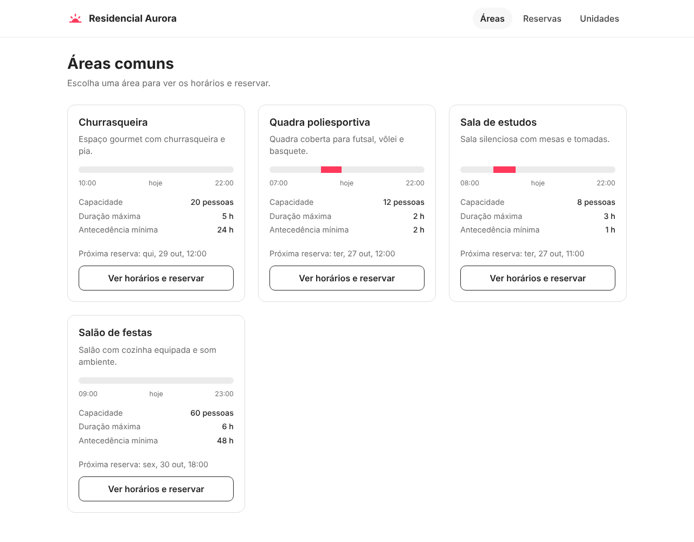
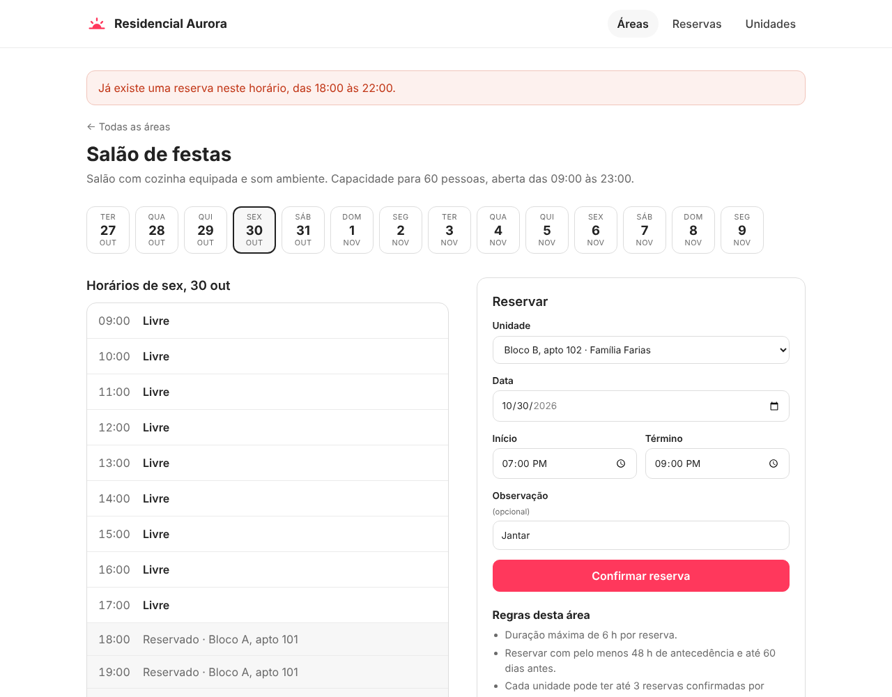
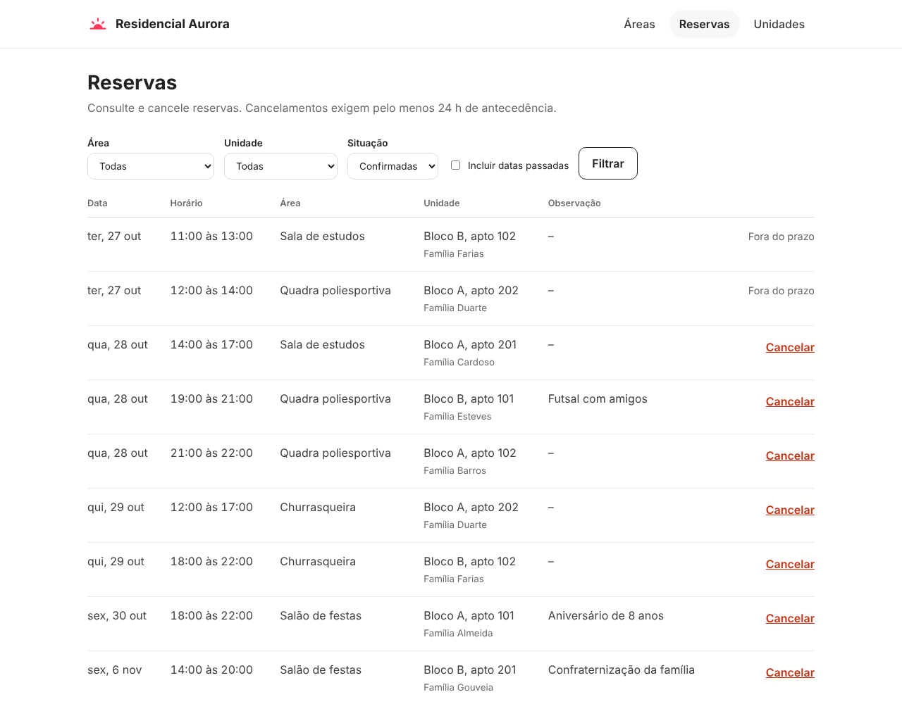
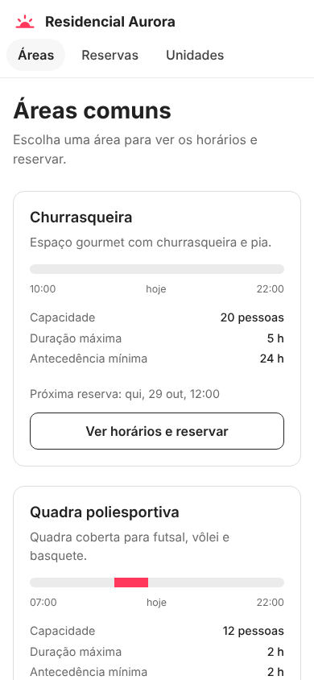

# Residencial Aurora: reservas de áreas comuns

[](https://github.com/BrunoDS13/project-condominio/actions/workflows/tests.yml)

Sistema web para um condomínio reservar áreas comuns (salão de festas, churrasqueira, quadra e sala de estudos). Feito com Flask e SQLite, com as regras de negócio separadas do resto do código e cobertas por testes.

> Projeto de portfólio. Todos os nomes, unidades e reservas são **fictícios**.



<details>
<summary>Mais telas</summary>

**Reserva com conflito de horário.** O sistema explica o motivo e mantém o formulário preenchido.



**Lista de reservas**, com filtros e cancelamento.



**No celular.**



</details>

## O que o sistema faz
- **Áreas comuns** com uma barra que mostra, num relance, o que está ocupado hoje.
- **Linha do tempo por dia**: escolha a data entre os próximos 14 dias e clique num horário livre para preencher a reserva.
- **Reserva com validação**: todos os motivos de recusa aparecem de uma vez, e o formulário continua preenchido.
- **Cancelamento** com confirmação, respeitando o prazo.
- **Lista de reservas** com filtro por área, unidade e situação.
- **Unidades**: cadastro e quanto do limite mensal cada uma já usou.

## Regras de negócio
| Regra | Valor |
|---|---|
| Horário de funcionamento | cada área tem o seu (ex.: quadra das 07:00 às 22:00) |
| Duração máxima | por área (ex.: salão 6 h, quadra 2 h) |
| Antecedência mínima para reservar | por área (ex.: salão 48 h, sala de estudos 1 h) |
| Antecedência máxima | 60 dias |
| Reservas confirmadas por unidade no mês | até 3 |
| Conflito de horário | não pode sobrepor outra reserva confirmada da mesma área (horários encostados são permitidos) |
| Cancelamento | com pelo menos 24 h de antecedência |

Reservas canceladas liberam o horário na hora.

## Decisões de projeto
- **Regras puras em `condominio/regras.py`.** São funções que só recebem dados e devolvem o resultado, sem banco nem Flask. Por isso são fáceis de ler e de testar.
- **Transação na hora de reservar.** `servicos.reservar` usa `BEGIN IMMEDIATE`, então a checagem de conflito e a gravação acontecem sem que outra pessoa reserve o mesmo horário no meio.
- **Relógio injetável.** O app recebe uma função `agora`, e os testes passam um horário fixo. Assim, nenhum teste depende do dia em que roda.
- **SQL parametrizado** em todas as consultas.
- **Dados de exemplo obedecem às mesmas regras.** O carregador de dados fictícios passa pelo mesmo serviço de reserva que a tela usa.

## Como rodar
```bash
git clone https://github.com/BrunoDS13/project-condominio.git
cd project-condominio
python3 -m venv .venv
source .venv/bin/activate        # Windows: .venv\Scripts\activate
pip install -r requirements.txt
python app.py
```
Abra http://127.0.0.1:5000. Na primeira vez, com o banco vazio, o app carrega os dados fictícios sozinho. O banco fica no arquivo `condominio.db`; para recomeçar, apague-o.

| Variável | Para que serve | Padrão |
|---|---|---|
| `SECRET_KEY` | chave do Flask para as mensagens da tela. Defina em produção. | aleatória a cada execução |
| `FLASK_DEBUG` | use `1` para o modo debug em desenvolvimento | desligado |

## Testes
```bash
pytest
```
Rodam também no GitHub Actions a cada push, no Python 3.11 e no 3.12.

## Estrutura
```
app.py                  # rotas Flask
condominio/db.py        # tabelas e consultas SQL
condominio/regras.py    # regras de negócio (funções puras)
condominio/servicos.py  # junta regras e banco: reservar e cancelar
condominio/seed.py      # dados fictícios para demonstração
templates/              # páginas HTML
static/                 # CSS
tests/                  # testes das regras, do banco, dos serviços e das telas
docs/                   # imagens do README
```

## Próximos passos
- Login com perfis (síndico e morador): o morador só reserva para a própria unidade.
- Painel do síndico para criar e editar áreas.
- Taxa de uso e bloqueio de datas para manutenção.

## Tecnologias
Python, Flask, SQLite, HTML, CSS e pytest.

## Licença
[MIT](LICENSE)
